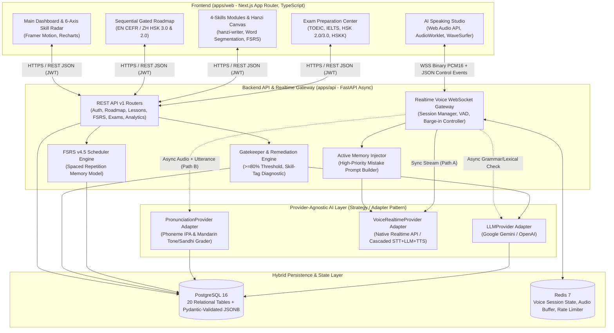
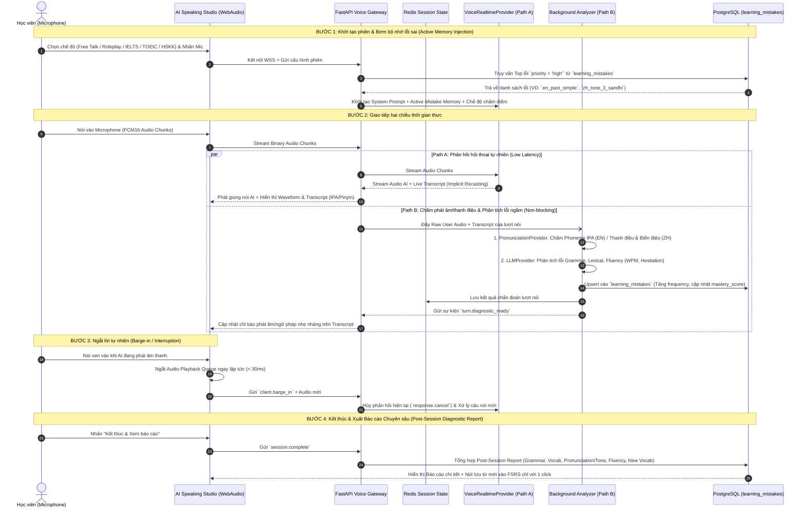
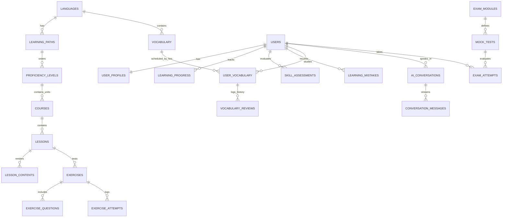

# LINGUAAI – KIẾN TRÚC HỆ THỐNG, THIẾT KẾ KỸ THUẬT & NHẬT KÝ LÀM VIỆC (ENGINEERING WORKLOG)

> **Dự án:** LinguaAI – AI-Powered Adaptive Language Learning & Real-Time Voice Tutor Platform  
> **Ngôn ngữ mục tiêu:** Tiếng Anh (CEFR A1–C2, TOEIC 4 kỹ năng, IELTS Academic & General) & Tiếng Trung Mandarin (Pinyin & Tones Foundation, HSK 3.0 Cấp 1–9 đối chiếu HSK 2.0 Cấp 1–6, HSKK Sơ–Trung–Cao cấp)  
> **Kiến trúc sư & Kỹ sư chính:** Senior Principal Full-stack Engineer, AI Voice/Audio Systems Engineer & Product Architect  
> **Cập nhật lần cuối:** 2026-11-10  

---

## MỤC LỤC
1. [Nhật ký Làm việc & Theo dõi Tiến độ (Engineering Worklog)](#1-nhật-ký-làm-việc--theo-dõi-tiến-độ-engineering-worklog)
2. [Nguyên tắc Kỹ thuật Cốt lõi (Core Engineering Principles)](#2-nguyên-tắc-kỹ-thuật-cốt-lõi-core-engineering-principles)
3. [Kiến trúc Tổng thể Hệ thống (System Architecture)](#3-kiến-trúc-tổng-thể-hệ-thống-system-architecture)
4. [Luồng xử lý Real-time Voice AI & Chấm Phát âm/Thanh điệu (Dual-Path Architecture)](#4-luồng-xử-lý-real-time-voice-ai--chấm-phát-âmthanh-điệu-dual-path-architecture)
5. [Thiết kế Provider-Agnostic AI Layer (Strategy / Adapter Pattern)](#5-thiết-kế-provider-agnostic-ai-layer-strategy--adapter-pattern)
6. [Cấu trúc Thư mục Monorepo Chuẩn Production](#6-cấu-trúc-thư-mục-monorepo-chuẩn-production)
7. [Thiết kế Chi tiết Hybrid Database Schema (20 Bảng PostgreSQL + JSONB)](#7-thiết-kế-chi-tiết-hybrid-database-schema-20-bảng-postgresql--jsonb)
8. [Kế hoạch Chi tiết Phase 1: Foundation, Database Schema & AI Curriculum Seeder](#8-kế-hoạch-chi-tiết-phase-1-foundation-database-schema--ai-curriculum-seeder)
9. [Lộ trình Chi tiết các Phase Tiếp theo (Phase 2 – Phase 6)](#9-lộ-trình-chi-tiết-các-phase-tiếp-theo-phase-2--phase-6)

---

## 1. NHẬT KÝ LÀM VIỆC & THEO DÕI TIẾN ĐỘ (ENGINEERING WORKLOG)

Bảng trạng thái tổng quan của 6 giai đoạn phát triển (sẽ được cập nhật liên tục sau mỗi bước triển khai):

| Phase | Tên Giai đoạn | Trạng thái | Tiến độ | Ngày cập nhật | Ghi chú nghiệm thu |
| :---: | :--- | :---: | :---: | :---: | :--- |
| **Phase 0** | **System Architecture & Technical Blueprint** | ✅ Hoàn thành | 100% | 2026-11-10 | Đã hoàn tất thiết kế tổng thể, sơ đồ luồng Voice AI, 20+ bảng DB và API Phase 1. |
| **Phase 1** | **Foundation, Hybrid DB Schema & AI Curriculum Seeder** | ✅ Hoàn thành | 100% | 2026-11-11 | Đã hoàn thành Monorepo, 22 bảng SQLAlchemy 2.0 + JSONB, Seeder EN/ZH, Gatekeeper >=80%, Remediation & UI. |
| **Phase 2** | **AI Voice Tutor & Structured Mistake Memory** | ⏳ Sẵn sàng triển khai | 0% | - | Speaking Studio, VAD, Barge-in, Dual-Path Acoustic/Tone Analyzer, Post-Session Report. |
| **Phase 3** | **Four Skills Interactive Modules & FSRS Engine** | 📋 Đã lên kế hoạch | 0% | - | Listening Loop, Reading Word Segmentation, Writing Grader + `hanzi-writer`, FSRS v4.5. |
| **Phase 4** | **Adaptive Personalization, Gatekeeper & Remediation** | 📋 Đã lên kế hoạch | 0% | - | Radar Analytics, Gatekeeper >=80%, AI Remediation Generator, Active Memory Injection. |
| **Phase 5** | **Exam Preparation Center (TOEIC, IELTS, HSK 2.0/3.0, HSKK)** | 📋 Đã lên kế hoạch | 0% | - | Phòng thi bấm giờ, chấm điểm theo Rubric, quy đổi Band/Score. |
| **Phase 6** | **Production Hardening, Testing & Audio Latency Optimization** | 📋 Đã lên kế hoạch | 0% | - | Pytest, Playwright/Vitest, WebSocket audio chunk tuning, Docker production build. |

### Chi tiết Nhật ký theo Ngày (Changelog)

#### 📅 Ngày 2026-11-10 – Khởi tạo Kiến trúc & Lập Kế hoạch Phase 1
- **[DONE]** Phân tích toàn diện yêu cầu nghiệp vụ EdTech song ngữ Anh – Trung (CEFR, TOEIC, IELTS, Pinyin, HSK 3.0 9 cấp vs HSK 2.0 6 cấp, HSKK).
- **[DONE]** Thiết kế sơ đồ luồng dữ liệu tổng thể và luồng xử lý **Dual-Path Real-time Voice AI** (tách biệt luồng hội thoại đồng bộ độ trễ thấp với luồng chấm phát âm Phoneme/Tone & phân tích ngữ pháp bất đồng bộ).
- **[DONE]** Thiết kế cấu trúc thư mục Monorepo (`apps/api`, `apps/web`, `docker-compose.yml`).
- **[DONE]** Đặc tả toàn bộ 20 bảng cơ sở dữ liệu PostgreSQL kết hợp `JSONB` (kiểm tra bằng Pydantic v2).
- **[DONE]** Thiết kế danh sách REST API Endpoints và kế hoạch dữ liệu thật cho **AI Curriculum Seeder** của Phase 1.

#### 📅 Ngày 2026-11-11 – Hoàn thành Triển khai & Kiểm thử Tự động PHASE 1 (100% Pass)
- **[DONE] Monorepo & DevOps:** Khởi tạo cấu trúc `apps/api`, `apps/web`, `docker-compose.yml`, `.env.example`, `.gitignore`, `README.md`.
- **[DONE] Hybrid Database Schema (22 Bảng):** Xây dựng toàn bộ SQLAlchemy 2.0 Async ORM models (`languages`, `users`, `user_profiles`, `learning_paths`, `proficiency_levels`, `courses`, `lessons`, `lesson_contents`, `exercises`, `exercise_questions`, `learning_progress`, `exercise_attempts`, `skill_assessments`, `learning_mistakes`, `vocabulary`, `user_vocabulary`, `vocabulary_reviews`, `ai_conversations`, `conversation_messages`, `exam_modules`, `mock_tests`, `exam_attempts`) + Alembic Migration `0001_initial_linguaai_schema.py`.
- **[DONE] Provider-Agnostic AI Layer:** Triển khai `LLMProvider`, `PronunciationProvider` và `AIProviderFactory` hỗ trợ Google Gemini, OpenAI và bộ sinh bài tập học bù thích ứng (Adaptive Pedagogical Engine).
- **[DONE] AI Curriculum Seeder (`run_seed.py`):** Tự động nạp dữ liệu thực tế cho:
  - **Tiếng Anh:** Lộ trình 6 cấp CEFR (`A1 -> C2`), bài học chi tiết A1–A2 (Collocations, IPA, Present Simple, Subject-Verb Agreement, Connected Speech, Past Simple) & bộ câu hỏi Gatekeeper.
  - **Tiếng Trung Mandarin:** Lộ trình Pinyin & Biến điệu (`Tone Sandhi 3+3`, biến điệu `一 yī` và `不 bù`, phân biệt `z/c/s` vs `zh/ch/sh/r`) $\rightarrow$ `HSK 3.0 Band 1..9` kèm bảng quy chiếu rõ ràng với `HSK 2.0 Level 1..6` & `HSKK`, đầy đủ Chữ Hán giản thể, Pinyin, Âm Hán-Việt, Nghĩa tiếng Việt, Thứ tự nét (Stroke Order).
- **[DONE] Frontend Next.js (App Router, TypeScript, Tailwind CSS):**
  - Hoàn thiện App Shell (Sidebar, Topbar chuyển đổi ngôn ngữ tức thì `🇨🇳 Tiếng Trung` $\leftrightarrow$ `🇬🇧 Tiếng Anh`, Streak, XP).
  - Hoàn thiện Main Dashboard (`/`): Biểu đồ Radar 6 kỹ năng (SVG), Cảnh báo đối chiếu HSK 3.0 vs HSK 2.0, Bài học đề xuất tiếp theo, Sổ cái lỗi sai (`learning_mistakes`), Hàng đợi FSRS và Phản hồi AI Voice Tutor.
  - Hoàn thiện Sequential Learning Roadmap (`/roadmap`) và Interactive Lesson & Gatekeeper Assessment (`/lessons/[id]`) kèm luồng chấm điểm mở khóa (`>= 80%`) và luồng học bù AI Remediation (`< 80%`).
- **[DONE] E2E Test Verification (`tests/test_phase1_e2e.py`):** 9/9 kịch bản kiểm thử Backend & Database PASS 100%.
- **[NEXT]** Chờ nghiệm thu Phase 1 từ Product Owner để chuyển sang **Phase 2 (AI Voice Tutor & Speaking Studio)**.

---

## 2. NGUYÊN TẮC KỸ THUẬT CỐT LÕI (CORE ENGINEERING PRINCIPLES)

1. **Production-Ready & Modular Monorepo Architecture:**
   - Tách biệt hoàn toàn giữa Frontend (`apps/web` – Next.js App Router, TypeScript strict) và Backend (`apps/api` – Python 3.11+, FastAPI Async, SQLAlchemy 2.0, Pydantic v2).
   - Đóng gói đồng nhất bằng `docker-compose.yml` gồm 4 dịch vụ: `postgres`, `redis`, `api`, `web`.
2. **No Mock / No Stub Traps:**
   - Tuyệt đối không dùng dữ liệu giả hardcode trên giao diện. Mọi số liệu trên Dashboard, Learning Roadmap, Bài học, Từ vựng FSRS và Sổ cái lỗi sai (`learning_mistakes`) đều được truy vấn từ PostgreSQL thông qua API thực tế.
   - Cung cấp công cụ **AI Curriculum Seeder (`run_seed.py`)** tự động nạp dữ liệu giáo trình chuẩn cho Tiếng Anh (A1–A2 + khung B1–C2, TOEIC, IELTS) và Tiếng Trung (Pinyin & Biến điệu + HSK 3.0 Band 1 đối chiếu HSK 2.0 Level 1).
3. **Provider-Agnostic AI Layer (Strategy / Adapter Design Pattern):**
   - Mọi tác vụ AI (`LLMProvider`, `VoiceRealtimeProvider`, `STTProvider`, `TTSProvider`, `PronunciationProvider`) đều giao tiếp qua Interface chuẩn và có thể chuyển đổi nhà cung cấp qua biến môi trường `.env` mà không phải sửa bất kỳ dòng code nghiệp vụ nào.
4. **Hybrid Database Modeling (Relational + Validated JSONB):**
   - Thực thể cốt lõi (Users, Languages, Levels, Courses, Lessons, Progress, Mistakes, Vocabulary, FSRS states) dùng bảng quan hệ chặt chẽ với đầy đủ khóa ngoại và chỉ mục.
   - Nội dung bài học đa phương tiện và câu hỏi đa hình của TOEIC, IELTS, HSK 2.0/3.0 dùng trường `JSONB` được kiểm tra nghiêm ngặt bằng **Pydantic v2 Discriminated Unions**.
5. **Sequential & Gated Progression + Adaptive Remediation:**
   - Học viên bắt buộc học theo trình tự và phải đạt **>= 80%** tại bài đánh giá cấp độ/đơn vị bài học (`unit_assessment`) để mở khóa bài tiếp theo.
   - Nếu **< 80%**, hệ thống gom các `skill_tags` bị sai, ghi vào `learning_mistakes` và tự động sinh bài tập bù lỗ hổng (**Remedial Exercises**).
6. **Phân tách rõ HSK 3.0 (3 giai đoạn – 9 cấp) và HSK 2.0 (6 cấp):**
   - Không đánh đồng hai hệ thống. Mọi cấp độ và từ vựng tiếng Trung đều lưu rõ `hsk3_level` (`HSK3-1`..`HSK3-9`) và `hsk2_equivalent` (`HSK2-1`..`HSK2-6`) kèm giải thích sự khác biệt về yêu cầu từ vựng, chữ viết và ngữ pháp.

---

## 3. KIẾN TRÚC TỔNG THỂ HỆ THỐNG (SYSTEM ARCHITECTURE)



---

## 4. LUỒNG XỬ LÝ REAL-TIME VOICE AI & CHẤM PHÁT ÂM/THANH ĐIỆU (DUAL-PATH ARCHITECTURE)

### 4.1. Tại sao phải dùng kiến trúc Dual-Path (Hai luồng độc lập)?
Trong các hệ thống hội thoại AI thông thường, mô hình STT hoặc Multimodal LLM thường tự động "đoán và sửa" từ bị phát âm sai dựa vào ngữ cảnh câu (ví dụ: người học phát âm sai thanh điệu `mǎi` [mua] thành `mài` [bán], hoặc đọc thiếu âm đuôi `/t/`, `/d/` trong tiếng Anh nhưng LLM vẫn hiểu đúng từ). Nếu chỉ dùng 1 luồng LLM duy nhất:
- Hoặc AI bắt lỗi liên tục làm đứt mạch giao tiếp và tăng độ trễ.
- Hoặc AI tự sửa lỗi âm thanh trong lúc nhận diện khiến hệ thống không thể chấm điểm chính xác phát âm/thanh điệu.

Do đó, **LinguaAI** tách quá trình xử lý giọng nói thành **2 luồng song song**:
1. **Path A – Luồng Hội thoại Đồng bộ (Synchronous Conversation Path):**
   - Tối ưu độ trễ thấp nhất, giữ vai trò người thầy/người bạn bản xứ kiên nhẫn.
   - Sử dụng kỹ thuật **Implicit Recasting** (khéo léo lặp lại ý của học viên bằng câu chuẩn ngữ pháp tự nhiên mà không làm gián đoạn cuộc trò chuyện).
   - Hỗ trợ **Barge-in (Ngắt lời tức thì)**: Khi VAD phát hiện học viên bắt đầu nói trong lúc AI đang trả lời, Frontend lập tức dừng phát âm thanh (`< 30ms`) và gửi tín hiệu `client.barge_in` để Backend hủy luồng sinh âm thanh cũ.
2. **Path B – Luồng Phân tích Âm học & Ngôn ngữ Bất đồng bộ (Asynchronous Diagnostic Path):**
   - Nhận bản sao `Raw Audio Buffer (PCM16)` của từng câu học viên vừa nói.
   - Đưa qua **`PronunciationProvider`** để chấm điểm âm vị học (**Phoneme-level IPA** cho tiếng Anh; **Initial/Final + Tone 1–4/Neutral + Tone Sandhi** cho tiếng Trung).
   - Đưa qua **`LLMProvider`** chạy ngầm để bắt lỗi ngữ pháp, từ vựng, tính toán tốc độ nói (WPM), độ ngập ngừng (Hesitation/Filler words) và ghi trực tiếp vào bảng `learning_mistakes`.

### 4.2. Sơ đồ Tuần tự (Sequence Diagram) của AI Speaking Studio



---

## 5. THIẾT KẾ PROVIDER-AGNOSTIC AI LAYER (STRATEGY / ADAPTER PATTERN)

Hệ thống định nghĩa 5 giao diện trừu tượng tại `apps/api/app/ai/interfaces/` và khởi tạo qua `AIProviderFactory` dựa trên biến môi trường trong `.env`:

| Interface | Các phương thức cốt lõi | Các Adapter hỗ trợ qua `.env` | Vai trò trong LinguaAI |
| :--- | :--- | :--- | :--- |
| **`LLMProvider`** | `generate_text()`, `generate_structured(schema)`, `stream_chat()` | `gemini` (Google Gemini), `openai` (OpenAI GPT), `local_fallback` (Deterministic Rule + Template Engine khi chạy offline/test) | Chấm bài Writing theo Rubric, phân tích lỗi ngữ pháp/từ vựng, giải thích tiếng Việt, sinh bài tập học bù (`Remediation`), tách từ Reading. |
| **`VoiceRealtimeProvider`** | `start_session()`, `send_audio()`, `interrupt()`, `receive_events()`, `close()` | `openai_realtime`, `gemini_live`, `cascaded_pipeline` (STT + LLM + TTS) | Điều phối hội thoại giọng nói hai chiều thời gian thực với độ trễ cực thấp và hỗ trợ Barge-in. |
| **`STTProvider`** | `transcribe_stream()`, `transcribe_buffer()` | `whisper` / `deepgram` / `gemini_audio` | Chuyển đổi giọng nói sang văn bản chính xác kèm word-level timestamps. |
| **`TTSProvider`** | `synthesize_stream()`, `synthesize_audio()` | `edge_neural` (Miễn phí, giọng bản xứ Anh/Trung cực tự nhiên), `elevenlabs`, `openai_tts`, `azure_tts` | Tạo giọng đọc bản xứ cho bài nghe Listening, phát âm từ vựng FSRS và luồng Cascaded Voice. |
| **`PronunciationProvider`** | `assess_pronunciation(audio, reference_text, lang)` | `azure_speech`, `acoustic_phoneme_tone_analyzer` (DSP Pitch Contour F0 + Phoneme Aligner) | Chấm điểm từng âm vị IPA (Tiếng Anh) và Thanh mẫu, Vận mẫu, 4 Thanh điệu + Thanh nhẹ + Biến điệu Tone Sandhi (Tiếng Trung). |

---

## 6. CẤU TRÚC THƯ MỤC MONOREPO CHUẨN PRODUCTION

```text
c:\Users\win10\Desktop\Chinese + English\
├── ARCHITECTURE_AND_WORKLOG.md         # File kiến trúc tổng thể & Nhật ký làm việc (File hiện tại)
├── README.md                           # Hướng dẫn cài đặt, chạy dự án và kiểm thử từng Phase
├── docker-compose.yml                  # Khởi chạy PostgreSQL 16, Redis 7, FastAPI Backend, Next.js Frontend
├── .env.example                        # Mẫu cấu hình toàn bộ biến môi trường
├── .gitignore
│
├── apps/
│   ├── api/                            # BACKEND (Python 3.11+, FastAPI, SQLAlchemy 2.0 Async, Pydantic v2)
│   │   ├── Dockerfile
│   │   ├── pyproject.toml
│   │   ├── requirements.txt
│   │   ├── alembic.ini
│   │   ├── alembic/
│   │   │   ├── env.py
│   │   │   └── versions/
│   │   │       └── 0001_initial_linguaai_schema.py
│   │   └── app/
│   │       ├── __init__.py
│   │       ├── main.py                 # FastAPI Entrypoint, Lifespan, CORS, Routers
│   │       ├── core/
│   │       │   ├── config.py           # Quản lý cấu hình từ .env
│   │       │   ├── database.py         # Async SQLAlchemy Engine & Session
│   │       │   ├── redis.py            # Async Redis Connection Pool
│   │       │   └── security.py         # Password Hashing (Bcrypt/Argon2) & JWT Tokens
│   │       ├── models/                 # 20 Bảng SQLAlchemy 2.0 ORM Models
│   │       │   ├── __init__.py
│   │       │   ├── base.py
│   │       │   ├── user.py             # languages, users, user_profiles
│   │       │   ├── curriculum.py       # learning_paths, proficiency_levels, courses, lessons, lesson_contents, exercises, exercise_questions
│   │       │   ├── progress.py         # learning_progress, exercise_attempts, skill_assessments, learning_mistakes
│   │       │   ├── vocabulary.py       # vocabulary, user_vocabulary, vocabulary_reviews
│   │       │   ├── voice.py            # ai_conversations, conversation_messages
│   │       │   └── exam.py             # exam_modules, mock_tests, exam_attempts
│   │       ├── schemas/                # Pydantic v2 Schemas & JSONB Validators
│   │       │   ├── auth.py
│   │       │   ├── user.py
│   │       │   ├── curriculum.py
│   │       │   ├── progress.py
│   │       │   └── dashboard.py
│   │       ├── ai/                     # Provider-Agnostic AI Layer
│   │       │   ├── factory.py
│   │       │   ├── interfaces/
│   │       │   │   ├── llm.py
│   │       │   │   ├── voice_realtime.py
│   │       │   │   ├── pronunciation.py
│   │       │   │   ├── stt.py
│   │       │   │   └── tts.py
│   │       │   └── providers/
│   │       │       ├── llm_providers.py
│   │       │       ├── voice_providers.py
│   │       │       └── pronunciation_providers.py
│   │       ├── services/               # Business Logic Layer
│   │       │   ├── auth_service.py
│   │       │   ├── dashboard_service.py
│   │       │   ├── roadmap_service.py
│   │       │   ├── assessment_service.py
│   │       │   └── fsrs_service.py
│   │       ├── api/
│   │       │   ├── deps.py
│   │       │   └── v1/
│   │       │       ├── router.py
│   │       │       ├── auth.py
│   │       │       ├── users.py
│   │       │       ├── dashboard.py
│   │       │       ├── roadmap.py
│   │       │       └── lessons.py
│   │       └── seeds/                  # AI Curriculum Seeder (Dữ liệu thật cho EN & ZH)
│   │           ├── __init__.py
│   │           ├── run_seed.py
│   │           ├── seed_english.py
│   │           └── seed_chinese.py
│   │
│   └── web/                            # FRONTEND (Next.js App Router, TypeScript, Tailwind CSS, shadcn/ui)
│       ├── Dockerfile
│       ├── package.json
│       ├── tsconfig.json
│       ├── next.config.mjs
│       ├── tailwind.config.ts
│       ├── postcss.config.mjs
│       └── src/
│           ├── app/
│           │   ├── globals.css
│           │   ├── layout.tsx
│           │   ├── (auth)/
│           │   │   ├── login/page.tsx
│           │   │   └── register/page.tsx
│           │   └── (app)/
│           │       ├── layout.tsx      # App Shell: Sidebar + Header (Language Switcher EN <-> ZH)
│           │       ├── page.tsx        # Main Dashboard (Radar Chart, Streak, Recommended Lesson, FSRS, Mistakes)
│           │       ├── roadmap/page.tsx # Sequential & Gated Roadmap (CEFR & HSK 3.0 vs HSK 2.0)
│           │       ├── lessons/[id]/page.tsx # Interactive Lesson Player + Stroke Order + Gatekeeper Quiz & AI Remediation
│           │       ├── speaking/page.tsx     # AI Speaking Studio (Hoàn thiện chuyên sâu ở Phase 2)
│           │       ├── listening/page.tsx    # Smart Listening Module (Hoàn thiện chuyên sâu ở Phase 3)
│           │       ├── reading/page.tsx      # Interactive Reading Module (Hoàn thiện chuyên sâu ở Phase 3)
│           │       ├── writing/page.tsx      # AI Writing & Hanzi Canvas (Hoàn thiện chuyên sâu ở Phase 3)
│           │       ├── vocabulary/page.tsx   # FSRS Spaced Repetition (Hoàn thiện chuyên sâu ở Phase 3)
│           │       ├── exams/page.tsx        # TOEIC / IELTS / HSK Exam Center (Hoàn thiện chuyên sâu ở Phase 5)
│           │       └── analytics/page.tsx    # Progress & Mistake Ledger (Hoàn thiện chuyên sâu ở Phase 4)
│           ├── components/
│           │   ├── layout/
│           │   │   ├── sidebar.tsx
│           │   │   └── topbar.tsx
│           │   ├── dashboard/
│           │   │   ├── skill-radar-chart.tsx
│           │   │   ├── recent-mistakes-card.tsx
│           │   │   └── due-vocabulary-card.tsx
│           │   └── lessons/
│           │       ├── chinese-content-block.tsx
│           │       ├── gatekeeper-exercise.tsx
│           │       └── remediation-panel.tsx
│           ├── context/
│           │   └── app-context.tsx     # Quản lý Auth, Active Language (en/zh), User Profile
│           ├── lib/
│           │   ├── api.ts              # Typed API Client kết nối trực tiếp tới FastAPI Backend
│           │   └── utils.ts
│           └── types/
│               └── index.ts            # TypeScript Interfaces đồng bộ với Pydantic Schemas
```

---

## 7. THIẾT KẾ CHI TIẾT HYBRID DATABASE SCHEMA (20 BẢNG POSTGRESQL + JSONB)

### Sơ đồ Quan hệ Thực thể Cốt lõi (ER Diagram)



### Danh mục 20 Bảng Cơ sở dữ liệu

| STT | Tên bảng | Phân hệ | Khóa chính & Ràng buộc | Các cột `JSONB` & Đặc tả quan trọng |
| :-: | :--- | :--- | :--- | :--- |
| 1 | `languages` | User & Profile | `code` (`PK`: `'en'`, `'zh'`) | `config_json`: Hệ thống chuẩn (CEFR/TOEIC/IELTS cho Anh; HSK 3.0 9 cấp + HSK 2.0 6 cấp + HSKK cho Trung). |
| 2 | `users` | User & Profile | `id` (`UUID`), `email` (`Unique`) | Lưu thông tin xác thực, `hashed_password`, `full_name`, `role`, `is_active`. |
| 3 | `user_profiles` | User & Profile | `id` (`UUID`), `user_id` (`Unique FK`) | `active_language_code`, `daily_goal_minutes`, `current_streak_days`, `total_xp`, `learning_preferences` (`JSONB`). |
| 4 | `learning_paths` | Curriculum | `id` (`UUID`), `slug` (`Unique`) | `language_code`, `path_type` (`general_cefr`, `zh_hsk3_roadmap`, `toeic`, `ielts`, `hskk`), `is_sequential`. |
| 5 | `proficiency_levels` | Curriculum | `id` (`UUID`), `Unique(path_id, order_index)` | `code` (`A1`..`C2` hoặc `PINYIN`, `HSK3-L1`..`HSK3-L9`), `hsk2_equivalent` (`HSK2-L1`..`HSK2-L6`), `passing_score_percent` (`80`), `standard_comparison_json` (`JSONB` phân biệt rõ HSK 3.0 vs HSK 2.0). |
| 6 | `courses` | Curriculum | `id` (`UUID`), `Unique(level_id, order_index)` | Đại diện cho từng **Learning Unit** trong một Level; `is_gatekeeper_required` (`True`). |
| 7 | `lessons` | Curriculum | `id` (`UUID`), `Unique(course_id, order_index)` | `lesson_type` (`vocabulary`, `grammar`, `listening`, `speaking`, `reading`, `writing`, `unit_assessment`), `passing_threshold` (`80`), `skill_tags` (`JSONB`). |
| 8 | `lesson_contents` | Curriculum | `id` (`UUID`), `FK(lesson_id)` | `content_type` (`theory`, `dialogue`, `vocab_spotlight`, `grammar_note`, `stroke_order_demo`, `tone_drill`), `body_json` (`JSONB`: Chữ Hán, Pinyin, Hán-Việt, nghĩa Việt, IPA, Stroke Order). |
| 9 | `exercises` | Curriculum | `id` (`UUID`), `FK(lesson_id)` | `exercise_type` (`practice`, `unit_gatekeeper`, `remedial`), `skill_focus`, `passing_score` (`80.0`). |
| 10 | `exercise_questions` | Curriculum | `id` (`UUID`), `FK(exercise_id)` | `question_type` (`multiple_choice`, `fill_blank`, `sentence_reorder`, `tone_discrimination`, `hanzi_stroke`), `skill_tag` (`Index`), `prompt_json` (`JSONB`), `answer_schema_json` (`JSONB`). |
| 11 | `learning_progress` | Progress | `id` (`UUID`), `Unique(user_id, lesson_id)` | `status` (`locked`, `unlocked`, `in_progress`, `completed`, `needs_remediation`), `best_score`, `attempts_count`. |
| 12 | `exercise_attempts` | Progress | `id` (`UUID`), `FK(user_id, exercise_id)` | `score_percent`, `passed`, `failed_skill_tags` (`JSONB`), `answers_detail_json` (`JSONB`), `remedial_payload_json` (`JSONB`). |
| 13 | `skill_assessments` | Progress | `id` (`UUID`), `Unique(user_id, language_code)` | 6 cột điểm (`listening_score`, `speaking_score`, `reading_score`, `writing_score`, `vocabulary_score`, `grammar_score`), `cefr_estimate`, `hsk3_estimate`, `hsk2_estimate`. |
| 14 | `learning_mistakes` | Mistake Memory | `id` (`UUID`), `Index(user_id, language_code, priority)` | `mistake_type` (`grammar`, `vocabulary`, `pronunciation`, `tone`, `hanzi_stroke`), `category_tag`, `incorrect_input`, `correct_suggestion`, `explanation_vi`, `frequency`, `mastery_score`, `priority` (`high`/`medium`/`low`). |
| 15 | `vocabulary` | FSRS Engine | `id` (`UUID`), `Index(language_code, term)` | `term` (Word / Hanzi), `phonetic` (IPA / Pinyin), `sino_vietnamese` (Hán-Việt), `meaning_vi`, `meaning_en`, `level_tag`, `hsk2_level_tag`, `metadata_json` (`JSONB`: Stroke order, synonyms, audio). |
| 16 | `user_vocabulary` | FSRS Engine | `id` (`UUID`), `Unique(user_id, vocabulary_id)` | Các tham số chuẩn FSRS: `state`, `stability`, `difficulty`, `elapsed_days`, `scheduled_days`, `reps`, `lapses`, `due_at` (`Index`). |
| 17 | `vocabulary_reviews` | FSRS Engine | `id` (`UUID`), `FK(user_vocabulary_id)` | `rating` (`1: Again`, `2: Hard`, `3: Good`, `4: Easy`), `state_before`, `stability_before`, `difficulty_before`, `reviewed_at`. |
| 18 | `ai_conversations` | Voice Tutor | `id` (`UUID`), `FK(user_id)` | `mode` (`free_talk`, `daily_scenario`, `roleplay`, `ielts_speaking`, `toeic_speaking`, `hskk_speaking`), `injected_mistake_ids` (`JSONB`), `post_session_report_json` (`JSONB`). |
| 19 | `conversation_messages` | Voice Tutor | `id` (`UUID`), `FK(conversation_id)` | `role`, `transcript_text`, `phonetic_annotation`, `pronunciation_assessment_json` (`JSONB`), `grammar_feedback_json` (`JSONB`). |
| 20 | `exam_modules`, `mock_tests`, `exam_attempts` | Exam Center | `id` (`UUID`) | Lưu cấu trúc đề thi TOEIC, IELTS, HSK 2.0, HSK 3.0, HSKK, thời gian làm bài và kết quả chấm theo Rubric (`JSONB`). |

---

## 8. KẾ HOẠCH CHI TIẾT PHASE 1: FOUNDATION, DATABASE SCHEMA & AI CURRICULUM SEEDER

### 8.1. Mục tiêu của Phase 1
1. Khởi tạo toàn bộ khung Monorepo (`apps/api`, `apps/web`, `docker-compose.yml`).
2. Xây dựng đầy đủ 20 bảng SQLAlchemy 2.0 Async + Alembic Migration + JWT Authentication.
3. Xây dựng khung **Provider-Agnostic AI Layer** (`interfaces` + `factory` + `remediation generator`).
4. Xây dựng **AI Curriculum Seeder** nạp dữ liệu thực tế cho:
   - **Tiếng Anh:** Lộ trình CEFR A1 $\rightarrow$ C2 (chi tiết đầy đủ nội dung & bài tập cho A1–A2: Vocabulary, Grammar, Listening/Connected Speech, Gatekeeper Assessment).
   - **Tiếng Trung:** Lộ trình Pinyin & Tones Foundation (Thanh mẫu, Vận mẫu, 4 thanh điệu + thanh nhẹ, Biến điệu Tone Sandhi) $\rightarrow$ HSK 3.0 Cấp 1–9 (chi tiết bài học HSK 3.0 Cấp 1 kèm bảng quy chiếu rõ ràng với HSK 2.0 Cấp 1, đầy đủ Chữ Hán giản thể, Pinyin, Âm Hán-Việt, Nghĩa tiếng Việt, Thứ tự nét chữ Hán và bài tập Gatekeeper).
5. Xây dựng giao diện **Next.js Frontend** hoạt động End-to-End với Backend:
   - Đăng nhập / Đăng ký (kèm nút Quick Demo Login cho tài khoản `learner@lingua.ai`).
   - **Main Dashboard:** Chuyển đổi ngôn ngữ tức thì (`English` $\leftrightarrow$ `Chinese Mandarin`), Biểu đồ năng lực 6 kỹ năng (Skill Radar Chart), Chuỗi ngày học (Streak), Bài học đề xuất tiếp theo, Thẻ từ vựng FSRS đến hạn, và Sổ cái lỗi sai (`learning_mistakes`).
   - **Sequential Learning Roadmap (`/roadmap`):** Sơ đồ lộ trình tuần tự có khóa/mở khóa (`locked`, `unlocked`, `completed`, `needs_remediation`), hiển thị rõ đối chiếu HSK 3.0 vs HSK 2.0.
   - **Interactive Lesson & Gatekeeper Assessment (`/lessons/[id]`):** Học lý thuyết, từ vựng (bật/tắt Pinyin, Hán-Việt, nghĩa Việt, xem thứ tự nét chữ Hán) và làm bài kiểm tra Gatekeeper (`>= 80%` mở khóa bài tiếp theo; `< 80%` tự động phân tích `skill_tags` bị sai và sinh bài tập học bù Remediation ngay trên màn hình).

### 8.2. Danh sách API Endpoints triển khai trong Phase 1
- `GET /api/v1/health` – Kiểm tra trạng thái Database, Redis và AI Provider.
- `POST /api/v1/auth/register` – Đăng ký học viên mới & khởi tạo lộ trình.
- `POST /api/v1/auth/login` – Đăng nhập nhận JWT Access/Refresh Token.
- `GET /api/v1/auth/me` – Lấy thông tin người dùng & hồ sơ học tập.
- `PATCH /api/v1/users/me/preferences` – Chuyển đổi ngôn ngữ (`en` / `zh`) & cài đặt mục tiêu học tập.
- `GET /api/v1/dashboard/overview?lang={en|zh}` – Lấy toàn bộ dữ liệu thực cho Dashboard theo ngôn ngữ.
- `GET /api/v1/roadmap?lang={en|zh}` – Lấy cây lộ trình tuần tự Levels $\rightarrow$ Units $\rightarrow$ Lessons kèm trạng thái khóa/mở khóa và bảng đối chiếu chuẩn.
- `GET /api/v1/lessons/{lesson_id}` – Lấy chi tiết bài học, từ vựng và câu hỏi kiểm tra (chặn nếu bài học đang bị `locked`).
- `POST /api/v1/lessons/{lesson_id}/submit` – Chấm điểm bài tập / Gatekeeper Assessment (`>= 80%` mở khóa bài kế tiếp; `< 80%` ghi nhận lỗi vào `learning_mistakes` và trả về bài tập bổ trợ Remediation).

---

## 9. LỘ TRÌNH CHI TIẾT CÁC PHASE TIẾP THEO (PHASE 2 – PHASE 6)

- **PHASE 2 – AI VOICE TUTOR & MISTAKE MEMORY:**
  - Triển khai WebSocket Voice Gateway (`/api/v1/voice/ws`), VAD, Barge-in, Dual-Path Processing (hội thoại trực tiếp + chấm phát âm Phoneme/Tone ngầm).
  - Giao diện **AI Speaking Studio** với AI Avatar, Waveform thời gian thực, 6 chế độ luyện nói (Free Talk, Daily Conversation, Roleplay, IELTS Speaking Part 1-2-3, TOEIC Speaking, Chinese HSKK) và Báo cáo chuyên sâu sau buổi nói.
- **PHASE 3 – FOUR SKILLS INTERACTIVE MODULES & FSRS ENGINE:**
  - **Listening:** Audio Player lặp từng câu (Sentence Loop), điều chỉnh tốc độ 0.75x–1.5x, bật/tắt độc lập Chữ Hán / Pinyin / Nghĩa Việt, điền từ, phân biệt thanh điệu & chẩn đoán lý do nghe sai (nối âm / nuốt âm / nhầm thanh điệu).
  - **Reading:** Tách từ ghép tiếng Trung (Word Segmentation), click tra từ điển Popup (IPA/Pinyin + Hán-Việt + Thứ tự nét + Giải thích ngữ cảnh), lưu 1-click vào FSRS.
  - **Writing:** Bảng vẽ luyện viết chữ Hán tương tác (`hanzi-writer`) chấm điểm thứ tự nét + AI Writing Grader chấm bài luận TOEIC/IELTS/HSK theo Rubric kèm bản viết nâng cấp.
  - **Vocabulary FSRS:** Thuật toán FSRS v4.5 hoàn chỉnh, Flashcards tương tác và hàng đợi ôn tập hàng ngày.
- **PHASE 4 – ADAPTIVE PERSONALIZATION & REMEDIATION LOOP:**
  - Bơm tự động các lỗi `priority: high` từ `learning_mistakes` vào System Prompt của AI Voice Tutor (Active Memory Injection).
  - Trang phân tích tiến độ chuyên sâu (`/analytics`) và trình sinh bài tập bù lỗ hổng tự động theo thời gian thực.
- **PHASE 5 – EXAM PREPARATION CENTER:**
  - Phòng luyện thi bấm giờ chuẩn thực tế cho **TOEIC** (4 kỹ năng), **IELTS Academic & General**, và **HSK 2.0 (Cấp 1–6) / HSK 3.0 (Cấp 1–9) + HSKK**.
- **PHASE 6 – PRODUCTION, TESTING & OPTIMIZATION:**
  - Bộ kiểm thử tự động (Unit & Integration Tests), tối ưu hóa độ trễ streaming âm thanh, kiểm soát chi phí/rate-limiting và hoàn thiện Docker Compose production.
